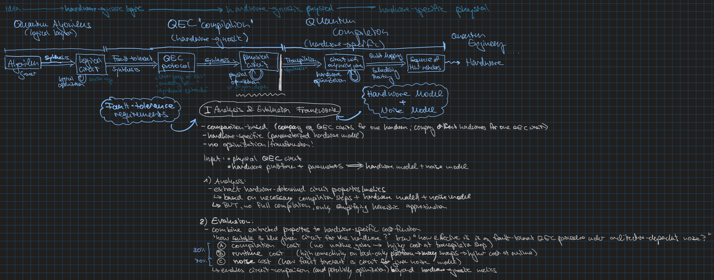
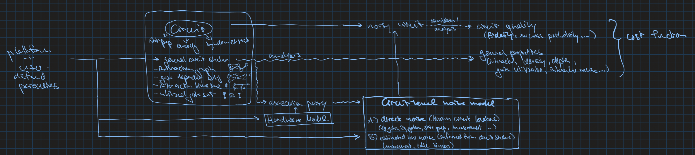

# Automated Hardware-Aware Analysis and Evaluation of Quantum Error-Correction Circuits

Sandbox repository for my Interdisciplinary Project in an Application Subject.

The "results" os this project will be contributed to [QECirc](https://github.com/qecirc/qecirc-website) and [MQT QECC](https://github.com/munich-quantum-toolkit/qecc).

> [!WARNING]
> Beware, as I am at the early stages of this project, everything (including documentation, aka this README) is still in progress and will be refined at a later point in time.


# Idea

Give me a QEC circuit and a hardware platform (with some parameters), and I'll tell you how well suited this circuit is for the platform. "Well suited" here means a combination of compilation cost, runtime cost, and how the hardware-specific noise disrupts the circuit in its quality/effectiveness.

THIS IS NOT A COMPILER: I want to be as compiler-agnostic as possible (to stay applicable to many use cases), while still capturing the inherent properties and restrictions that the respective platforms carry. For this, I want to construct abstract hardware models that find a good balance between these aspects.

Below is a first sketch (will be formalized and made pretty later) of my vision for this project and its position in the established software stack of quantum applications.
The **Analysis and Evaluation Framework** sits between the QEC layer and compilation layer of a quantum application's path from algorithm to executable hardware. 

The circuits I am looking at ("*physical circuits*", with physical from the perspective of the QEC point of view) are QEC gadgets, such as circuits to prepare a certain logical state $$\vert \psi_L \rangle$$, so important properties of there circuits are their fault tolerance wrt certain noise, and things like their logical error rate. While those circuits can already be optimized for certain hardware-agnostic metrics such as gate count or depth, usually this optimization stops there, and does not assume anything about compiler or hardware properties. I want to make a step in the direction of bringing hardware/compilation and QEC closer together, evaluating the suitability of such a circuit on a specific hardware, while also abstracting away specific compiler and hardware details. For this, I rely on abstracted hardware and noise models, and while I am taking much inspiration from the quantum compiler community and what hardware properties they deem important, I am trying to still be one abstraction level above them, to not get lost in a world too big for this project (I am really trying to avoid assumptions about qubit mapping or scheduling, because people smarter than me already spent much more time on these issues, than this project allows me). So finding fitting hardware models, as well as insightful circuit metrics, and analyzing a circuit wrt its fault-tolerant properties are my main tasks here.



## Scope

Supported Quantum Error-Correction Circuits:
- Encoding
- Logical-State Preparation
- Syndrome Extraction

Supported Hardware Platforms:
- Trapped Ions
- Neutral Atoms
- Superconducting Qubits

Below, there is another preliminary sketch - the data flow that I am planning for this framework. The user provides a QEC circuit (state preparation, encoding, syndrome extraction), and some parameters of the hardware-architecture they are interested in. These parameters are then used to construct an abstract hardware and noise model. The circuit is then analyzed *statically* using different representations (weighted interaction graph, gate-dependency DAG, per-qubit timelines), to extract metrics about how well it fits the hardware properties. Furthermore, the circuit is analyzed *dynamically* by running an abstract execution on the hardware model, emulating certain hardware events by means of an execution proxy. This is then used to, with the help of the noise model, construct a noisy circuit, that approximates the noise that running the circuit on the hardware could experience. This noisy circuit is then used to (probably in a sampling/Monte Carlo based method) extract information about its quality as a QEC circuit.
These statically and dynamically extracted metrics then are combined in a cost function, that evaluates the circuits suitability for the hardware. 



# Dev Setup


The project is managed with uv and requires Python 3.13 or newer. 

Create the virtual environment with the exact locked dependencies:

```bash
uv sync
```

Every command below runs inside this environment, either with `uv run <command>` or after `source .venv/bin/activate`.

Adding or removing dependencies (updates `pyproject.toml` and `uv.lock`):

```bash
uv add <package>
uv add --dev <package>
uv remove <package>
```

## Tests, Linter, Formatter, Type Checker

[](https://github.com/MaxieHelenBichmann/arQECt/actions/workflows/ci.yml)

```bash
uv run pytest                     # whole test suite in tests/
uv run pytest tests/models        # a single directory
uv run pytest -k dependency_dag   # tests matching a name
```

`ruff format` rewrites files in place, `ruff format --check` only reports:

```bash
uv run ruff check                 # lint (add --fix to apply safe fixes)
uv run ruff format                # format
uv run mypy src/                  # type-check
```

## Running Scripts

```bash
uv run python -m bm.model_accuracy.compiler
uv run python -m bm.performance.runner
```

only tests are Ai generated until now, will be adapted later
